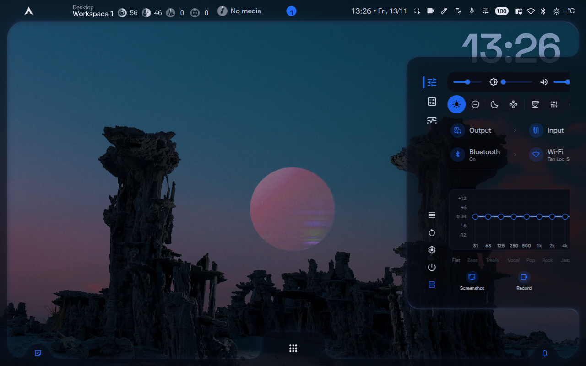
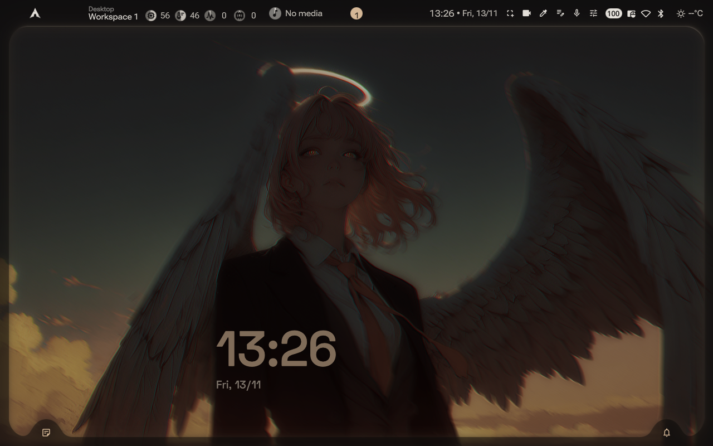
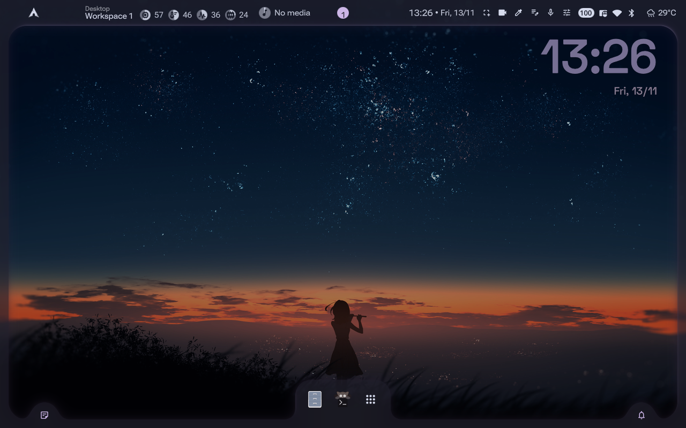
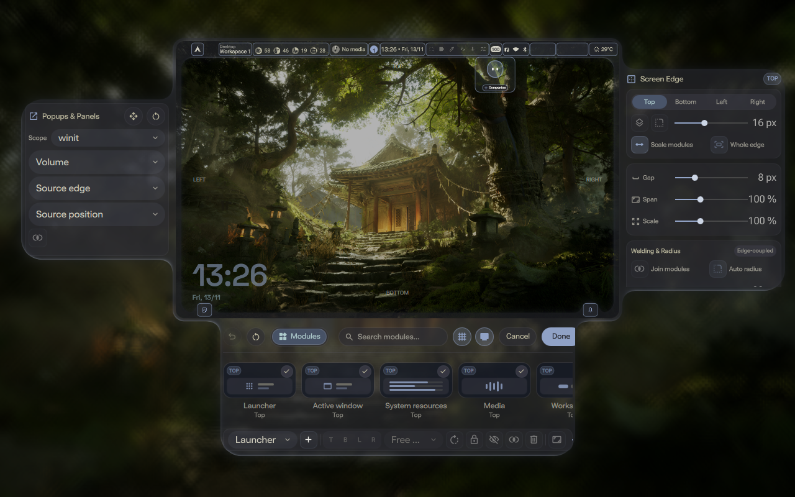
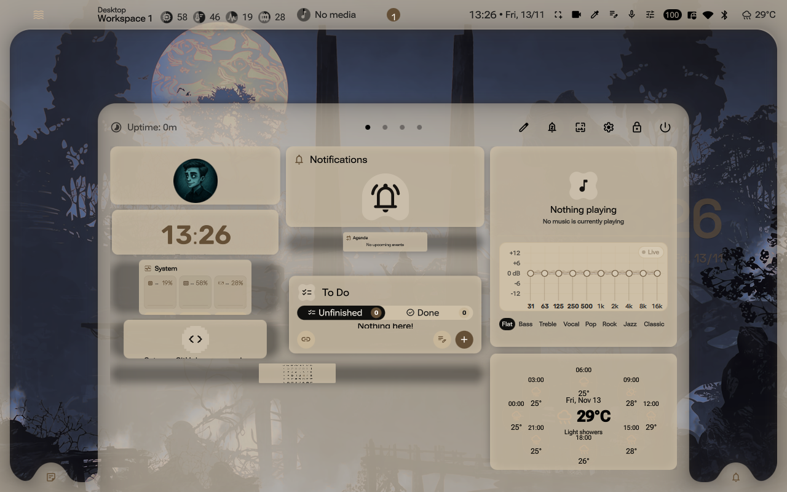
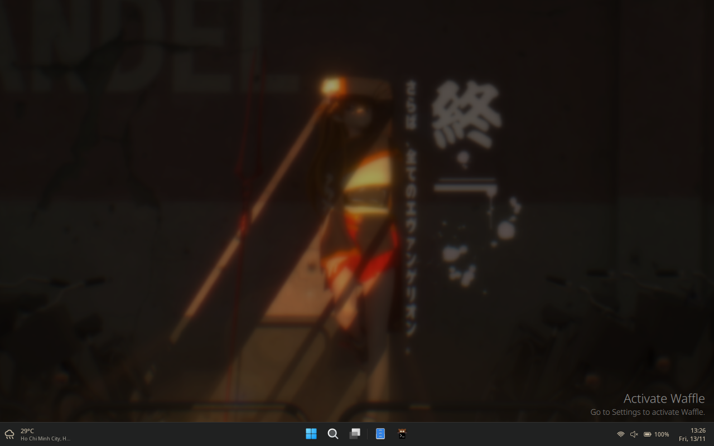

<div align="center">

# Alis `1.0.0`

**A responsive, Material You & Abyssal Wayland desktop shell built on Quickshell + Niri + Rust.**

[](VERSION)
[](#architecture--repository-layout)
[](#quick-start)
[](#architecture--repository-layout)

[Preset Gallery](#preset-showcase) · [Highlights](#key-features) · [Quick Start](#quick-start) · [Ecosystem](#ecosystem-repositories) · [Development Model](#development-model--release-cadence) · [Contracts](#architecture--regression-contracts)

</div>

---

> **Transparency & Release Cadence**
> - **LLM-Assisted Engineering:** Alis, along with its optional companion and integration packages, was **designed and built with the assistance of Large Language Models (LLMs)** for architecture iteration, QML/Rust implementation, shader prototyping, and automated regression testing.
> - **Update Schedule:** New feature releases and maintenance updates are published on a **quarterly, semi-annual, or annual** cadence rather than continuous rolling drops.

---

## Preset Showcase

Alis ships with adaptive Material You (`auto`) wallpaper extraction alongside curated multi-palette presets and two distinct shell families (**Abyss** perimeter chrome and **Waffle** Windows-11-inspired taskbar).

| Abyss · Auto Wallpaper Palette | Angel · Twilight Warm Minimal |
| :---: | :---: |
|  |  |
| Adaptive wallpaper-derived palette, Abyss perimeter rails, live Clock widget, and desktop chrome. | Warm amber twilight palette with halo wallpaper contrast and low-glare desktop framing. |

| Catppuccin Mocha | Kanagawa · Live Edit Stage |
| :---: | :---: |
|  |  |
| Lavender accents paired with centered bottom dock and subtle top status modules. | Interactive Desktop Edit Stage with 3-edge docks (`Popups & Panels`, `Screen Edge`, `Modules`). |

| Regalia Ivory · Unified Dashboard | Gruvbox Material · Waffle Taskbar |
| :---: | :---: |
|  |  |
| Light parchment surface tokens driving Dashboard calendar, weather, EQ, and To-Do cards. | Optional `Waffle` panel family with centered taskbar, start launcher, and widget tray. |

---

## Key Features

- **Abyssal Frame & Unified Customization Stages:** Smooth `OutCubic` Desktop Edit Stage for configuring Abyss Screen Edges (`Top`, `Bottom`, `Left`, `Right`), Popups & Panels (`<= 80%` centered flexible docks), Dashboard layouts (`Modules`, `Tabs`, `Layout & Grid`), and Desktop Widgets with snap-grid overlays and batch Canvas rendering.
- **Rust-Accelerated Native Daemons:** High-frequency wallpaper color quantization (`alis-theme`), input/shortcut helpers (`alis-inputd`), MPD metadata bridge (`alis-mpdd`), and native utilities (`alis-native`) keep Qt/QML UI threads responsive with idle warmup and zero-bounce sidebar slides.
- **Dynamic Presets & Application Auto-Theming:** Instant switching across built-in palettes (`auto`, `angel`, `catppuccin-mocha`, `kanagawa`, `regalia-ivory`, `gruvbox-material`, and more) synced cleanly to GTK, Qt, terminals, and Neovim.
- **Modular 3-Repo Design (Optional Add-ons, Default-Off):** Keep the core shell standalone or attach [Alis-Companion](https://github.com/llocphann/Alis-Companion) (Aqua/Octo pet, standalone `/swarm`, Voice, MCP/Skills/RAG) and [Alis-Intergration](https://github.com/llocphann/Alis-Intergration) (Nexus vault/knowledge suite, battery/thermal controls, hardware helpers).

---

## Quick Start

### Prerequisites

- **Compositor:** `niri` (Wayland session)
- **Runtime:** Pinned `quickshell` (`v0.3.2` toolchain via `alis-deps`)
- **Toolchain:** `rust` / `cargo`, `python3`, `fish`, `git`

### Install on Arch Linux / CachyOS

```bash
git clone https://github.com/llocphann/Alis.git
cd Alis
./setup install
```

Start or inspect the user service:

```bash
systemctl --user status alis.service
```

### Default Keybindings (Niri)

| Shortcut | Action |
| :--- | :--- |
| `Super + Space` / Launcher | App & action search |
| `Super + W` | Wallpaper & theme picker |
| `Super + G` | Overview / Workspace switcher |
| `Super + E` | File manager (configurable, including Yazi) |
| `Super + ,` | Settings window |

---

## Ecosystem Repositories

| Repository | Branch | Scope |
| :--- | :--- | :--- |
| [Alis](https://github.com/llocphann/Alis) | `dev` / `stable` | Core Quickshell desktop shell, Abyss chrome, Dashboard, Settings, and Rust backend |
| [Alis-Companion](https://github.com/llocphann/Alis-Companion) | `main` | Optional AI pet companion (`Aqua` / `Octo`), standalone `/swarm`, Pocket, and Skills/MCP |
| [Alis-Intergration](https://github.com/llocphann/Alis-Intergration) | `main` | Optional Obsidian/Nexus workspace, Graph view, EasyEffects/TLP/Thinkfan hardware integrations |

---

## Development Model & Release Cadence

1. **Designed with LLM Assistance:** Core refactoring, QML layout engineering, performance profiling, automated runtime tests, and documentation were crafted iteratively in collaboration with Large Language Models under maintainer review.
2. **Release Schedule:** Alis `1.0.0` marks the stable baseline. Subsequent updates and new features are delivered on a **quarterly, semi-annual, or annual** schedule.
3. **Architecture References:** See [ARCHITECTURE.md](ARCHITECTURE.md), [STRUCTURE.md](STRUCTURE.md), and [CHANGELOG.md](CHANGELOG.md) for subsystem details and version history.

---

## Architecture & Regression Contracts

The sections below document invariant shell ownership, copy brevity, and equalizer boundaries verified by automated repository checks.

### Settings Copy & Surface Ownership

- **Settings copy stays terse.** Section descriptions, helper lines, and control subtitles use only a few words or one short clause. Do not add paragraph-length explanation blocks inside Settings views.
- **Settings base surface has one owner.** Root window chrome and navigation rail ownership stay centralized so embedded and standalone Settings panes remain consistent.

### 2.1 Locked ownership contract — single Caelestia-style inverted frame

- In normal shell operation, Abyss renders the inverted corner/edge frame around the desktop while Normal Bar mode owns only the Bar body and active dock pills without duplicating peripheral backdrop layers.
- `scripts/test-shell-surface-contracts.py` is the regression gate guarding surface ownership, exclusive layer interactions, and edge anchoring.

## Equalizer implementation status

### Implemented

- `EqualizerService.qml` provides the Phase 1 backend/service contract and is disabled by default.

### Stabilizing

- Dashboard EQ preset visualization and per-preset EasyEffects synchronization hardening.

### Planned

- Live spectrum DSP feedback loops, custom curve persistence upgrades, and extended Sink profile routing remain planned/deferred rather than current release prerequisites.

---

## License

See [LICENSE](LICENSE).
