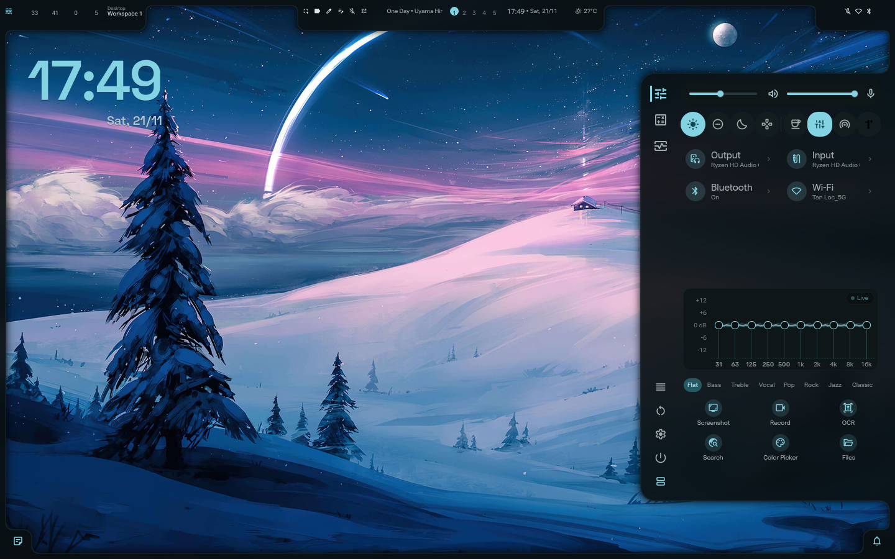
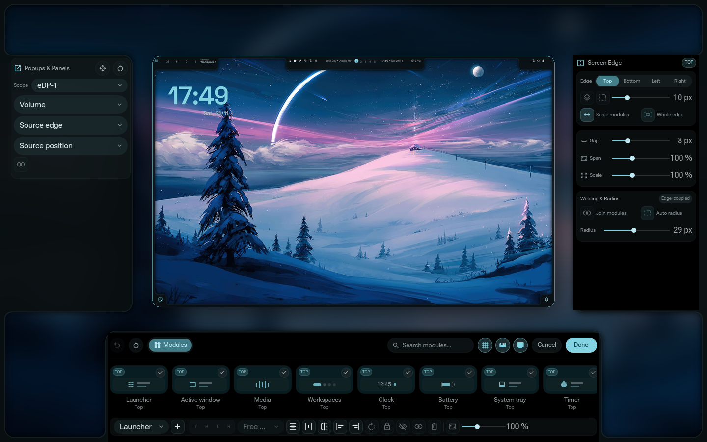
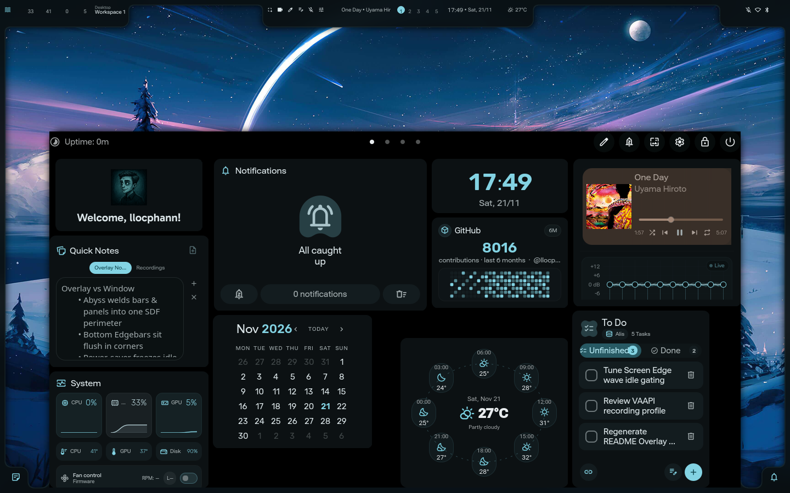
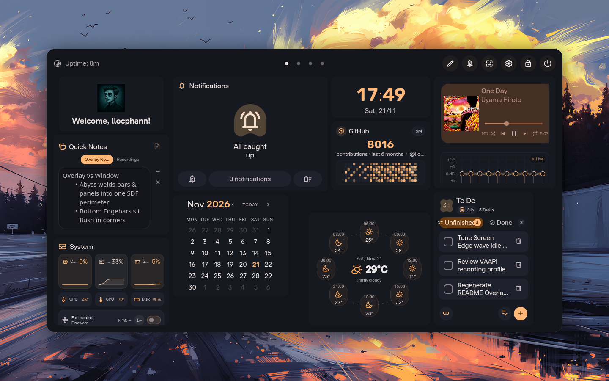
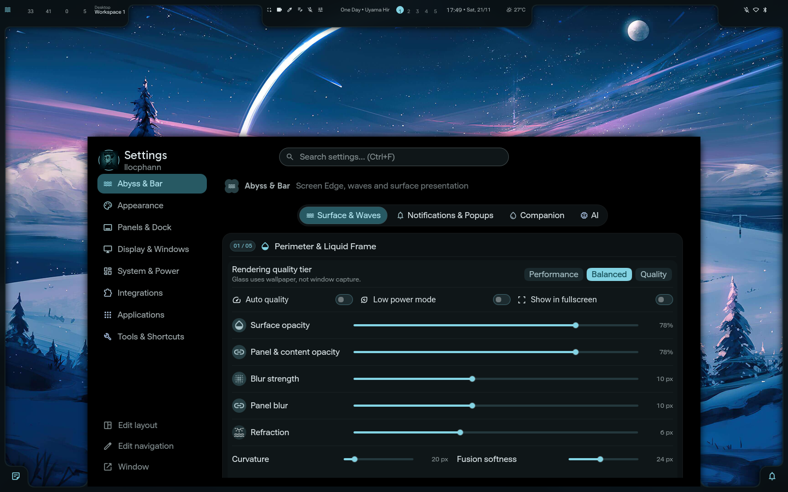
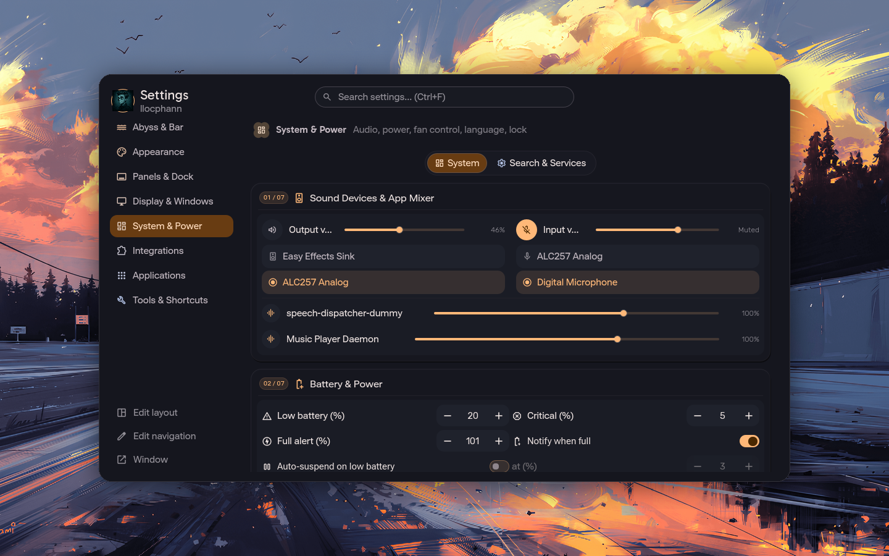
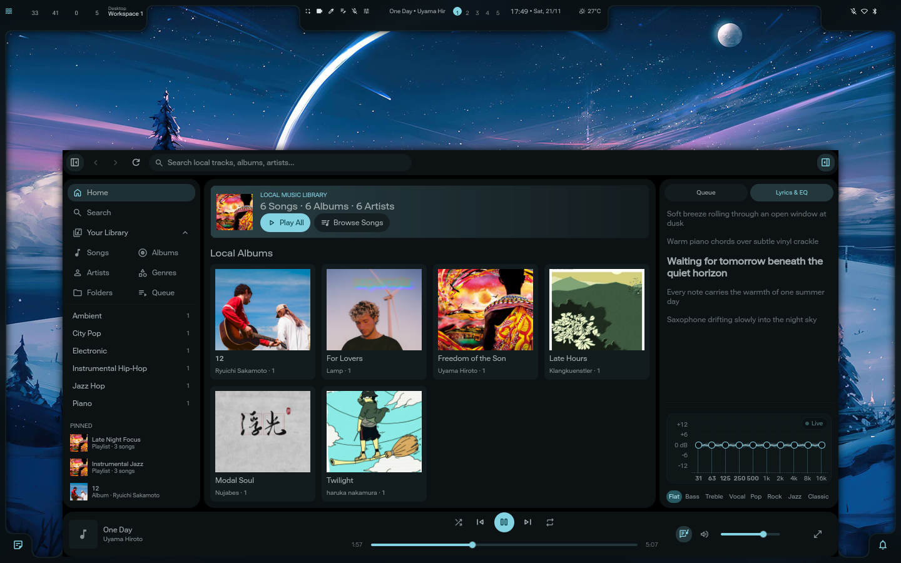
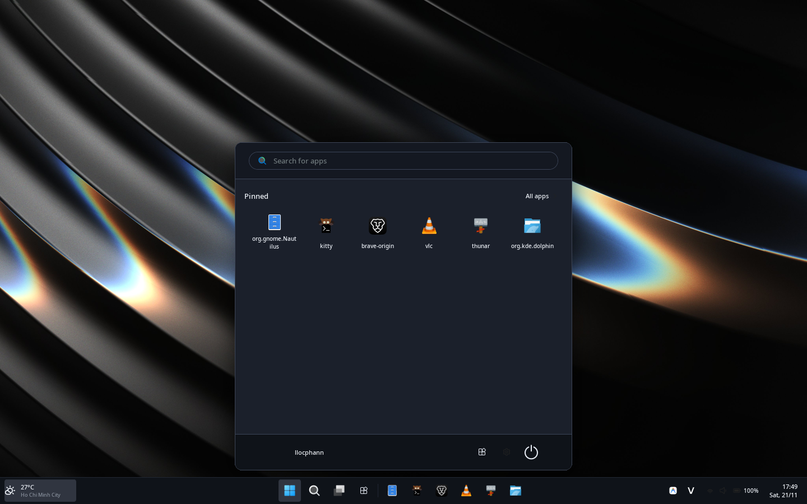

<div align="center">

# Alis

**A personal fork of [iNiR](https://github.com/snowarch/iNiR) built on Quickshell, Niri, and Rust — centered on the Abyss Overlay perimeter and tailored strictly for one workflow and hardware setup.**

[](https://github.com/snowarch/iNiR)
[](LICENSE)
[](#important-notes)

[Important Notes](#important-notes) · [How Alis Differs from Upstream iNiR](#how-alis-differs-from-upstream-inir) · [Visual Showcase](#visual-showcase) · [Ecosystem](#ecosystem-repositories) · [Quick Start](#quick-start)

</div>

---

## Important Notes

> **Please read before installing or opening issues:**
> - **Personal Fork Only — Not an Upstream Replacement:** Alis is a personal fork of **[snowarch/iNiR](https://github.com/snowarch/iNiR)** (which itself builds on [end-4/dots-hyprland](https://github.com/end-4/dots-hyprland) / *illogical-impulse*), maintained strictly for the author's own daily use. It is **not** intended to replace, compete with, or supersede upstream iNiR. If you want a community-maintained shell with general support, please use **[snowarch/iNiR](https://github.com/snowarch/iNiR)** directly.
> - **Single-Device Hardware Target:** Alis is developed and tuned specifically on a **ThinkPad T14 Gen 4 (AMD Ryzen 5 Pro, 32 GB RAM)** running Niri on Wayland. **Other devices or hardware configurations have not been tested.**
> - **Personal Workflow Scope Only:** Development focuses exclusively on features that serve the author's own workflow. **External feature requests outside what the author personally uses will not be implemented.**
> - **Developed Entirely with LLMs:** This repository — alongside [Alis-Companion](https://github.com/llocphann/Alis-Companion) and [Alis-Intergration](https://github.com/llocphann/Alis-Intergration) — was **built with 100% assistance from Large Language Models (LLMs)** across QML, GLSL shaders, Rust services, scripts, and validation checks.

---

## How Alis Differs from Upstream iNiR

While preserving upstream credits, GPL-3.0 licensing, core runtime structure, and legacy configuration compatibility from **[snowarch/iNiR](https://github.com/snowarch/iNiR)**, Alis diverges across architecture, presentation, and resource behavior:

| Area | Difference in Alis vs. Upstream iNiR |
| :--- | :--- |
| **Target Hardware & Scope** | Tuned solely for a **ThinkPad T14 Gen 4 (AMD Ryzen 5 Pro, 32 GB RAM)** on Niri (`Wayland`), focusing only on features the author uses daily. |
| **Abyss Overlay Perimeter (`modules/abyss/`)** | Introduces the custom **Abyss** (`abyss`) family alongside `ii` and `waffle`: a single-SDF inverted Screen Edge frame where Top Bar groups, corner-snapped Edgebars (`notesTimers`, `notificationActivity`), popouts, sidebars, Dashboard, Settings, and the 3-Edge **Desktop Edit Stage** weld directly into one continuous surface. |
| **Overlay vs. Window Presentation** | Supports both Screen-Edge-welded **Overlay Mode** (highlighted with Abyss) and standalone **Window Mode** across Dashboard and Settings. |
| **Material-Only Surface System** | Clamps global styling to `material` (`Appearance.globalStyle`), prunes legacy non-Material style branching, and layers nested surfaces cleanly using stepped HSL tonal shifts (`ColorUtils.tonalStep`). |
| **Rust Native Services (`native/`)** | Ships custom Rust binaries (`alis-native`, `alis-inputd`, `alis-mpdd`, `alis-theme`) for fast wallpaper color extraction, GTK/Qt/terminal/editor/browser theme syncing, MPD IPC, and telemetry. |
| **Pinned Runtime & Local Patches** | Targets pinned Quickshell **`v0.3.2`** (`alis-deps`) with local stability patches under [patches/](patches) (including safe hot-reload teardown). |
| **Media, Planners & Capture** | Adds a Sonora-inspired **Local Music** browser (synced Lyrics stacked above a 10-band EQ), **Weekly & Yearly Planners**, custom Dashboard tabs, **iRiS**-guided compact Settings, and an inline **Take Screenshot** annotation toolbar. |
| **Power & Resource Discipline** | Adapts idle animations to `power-saver` vs. balanced/performance profiles, evicts heavy idle overlay trees after 4 minutes (with an opt-in `Keep panels warm in RAM` toggle), uses VAAPI / bounded threads during recording compression, and cleans child cgroups cleanly via [scripts/alis](scripts/alis). |
| **Modular Optional Add-ons** | Moves AI companions and personal productivity workflows into optional, default-off sibling repositories ([Alis-Companion](https://github.com/llocphann/Alis-Companion) and [Alis-Intergration](https://github.com/llocphann/Alis-Intergration)). |

---

## Visual Showcase

### Abyss Overlay Mode Centerpiece

Abyss is Alis's signature Screen Edge architecture: Top Bar clusters, corner-snapped Bottom Edgebars, Quick Settings, Dashboard, Local Music, and Settings all weld directly into a single continuous liquid SDF perimeter rather than floating as disconnected boxes.

| Abyss Overlay · Desktop, Corner Edgebars & Right Sidebar | Abyss · 3-Edge Desktop Edit Stage |
| :---: | :---: |
|  |  |
| Continuous Abyss perimeter with grouped Top Bar modules, Bottom-Left & Bottom-Right corner-snapped Edgebars, and Right Quick Settings welded flush to the screen edge. | Centered miniature desktop framed by external Screen-Edge-welded `Popups & Panels`, `Modules`, and `Screen Edge` customization docks. |

---

### Overlay Mode vs. Window Mode

Alis pairs **Overlay Mode** (surface welded directly into the Abyss Screen Edge frame) with standalone **Window Mode** so you can switch between edge-integrated overlays and independent floating windows at any time.

| Dashboard · Abyss Overlay Mode *(Highlighted)* | Dashboard · Standalone Window Mode |
| :---: | :---: |
|  |  |
| 4-column Dashboard welded seamlessly into the bottom Abyss Screen Edge with live Media artwork + EQ, GitHub heatmap, System sensors, Calendar, Weather wheel, Notes & To Do. | Same balanced 4-column Dashboard presented as a standalone floating window frame for clear visual comparison against Overlay Mode. |

| Settings · Abyss Overlay Mode *(Highlighted)* | Settings · Standalone Window Mode |
| :---: | :---: |
|  |  |
| Screen Edge Overlay Settings (`Abyss & Bar · Surface & Waves`) fused directly with the bottom perimeter and single-column control plates. | Standalone floating Window Mode Settings (`System & Power`), contrasting Overlay perimeter integration. |

---

### Local Music & Alternate Waffle Panel Style

| Sonora-Inspired Local Music · Abyss Overlay | Waffle Panel Family · Centered Taskbar & Start Menu |
| :---: | :---: |
|  |  |
| Embedded Library sidebar, album cover grid, active playback transport, and synced Lyrics paired with the 10-band Equalizer inside the Abyss Overlay. | Runtime switch to the Windows 11-inspired Waffle taskbar and Start Menu over an unblurred dark abstract wave wallpaper. |

---

## Ecosystem Repositories

| Repository | Branch | Scope (Optional / Default-Off) |
| :--- | :--- | :--- |
| **[Alis](https://github.com/llocphann/Alis)** | `stable` / `dev` | Core desktop shell (`Abyss` & `Waffle` / `ii`), Dashboard, Local Music, Capture & Rust daemons |
| **[Alis-Companion](https://github.com/llocphann/Alis-Companion)** | `main` | 3D Aqua & Octo companions, local-first AI agent, Voice, Nexus RAG & standalone `/swarm` |
| **[Alis-Intergration](https://github.com/llocphann/Alis-Intergration)** | `main` | Obsidian Nexus Vault workspace, CEFR Spaced Repetition flashcards, Exercises Tracker, ThinkPad TLP & ThinkFan |

---

## Quick Start

> Tested **only** on Arch Linux / CachyOS on a **ThinkPad T14 Gen 4 (AMD Ryzen 5 Pro, 32 GB RAM)** running Niri (`Wayland`). Running on other devices is untested and unsupported.

### Prerequisites

- **Compositor:** `niri` (Wayland session)
- **Runtime:** Pinned Quickshell (`v0.3.2` via `alis-deps`)
- **Toolchain:** `rust` / `cargo`, `python3`, `fish`, `git`

### Install & Service Commands

```bash
git clone https://github.com/llocphann/Alis.git
cd Alis
./setup install
```

Manage the supervised user service:

```bash
systemctl --user status alis.service
alis restart
```

### Default Keybindings

| Shortcut | Action |
| :--- | :--- |
| `Super + Space` | App & command launcher |
| `Super + W` | Wallpaper & theme picker |
| `Super + G` | Overview / Workspace switcher |
| `Super + Shift + S` | Screenshot, Recording & OCR region tool |
| `Super + E` | File manager |
| `Super + ,` | Settings |
| `Super + /` | Keyboard & cheatsheet popup |

---

## Inspirations, Documentation & Credits

Alis stands on upstream work and design ideas from several open projects and concepts:

- **Upstream Foundation:** Forked from **[snowarch/iNiR](https://github.com/snowarch/iNiR)**, building on **[end-4/dots-hyprland](https://github.com/end-4/dots-hyprland)** (*illogical-impulse*).
- **Design & UX Inspirations:** Takes inspiration from **Caelestia** (single-SDF inverted Screen Edge frame and connected edge popouts), **Dux** (spatial panel hierarchy and clean card rhythm), **Serpantinum** (tonal layered surfaces and compact visual restraint), **Sonora** (Local Music library and queue/lyrics composition), and **iRiS** (guided Settings home and single-column plates).

Repository guides:
- [ARCHITECTURE.md](ARCHITECTURE.md) — Panel families, singletons, theming pipeline, IPC targets, and surface contracts
- [STRUCTURE.md](STRUCTURE.md) — Codebase directory guide and conventions
- [CONTRIBUTING.md](CONTRIBUTING.md) — Branch model (`dev` / `stable`), development workflow, and checks
- [CHANGELOG.md](CHANGELOG.md) — Change history

---

## License

Licensed under **GPL-3.0** in compliance with upstream iNiR and *illogical-impulse*. See [LICENSE](LICENSE).
