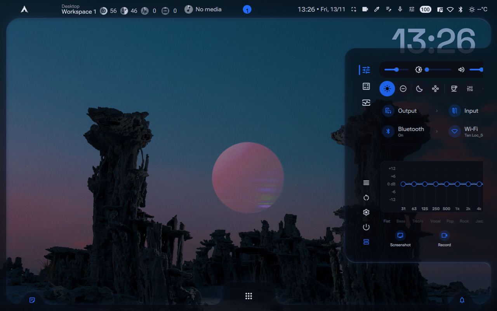
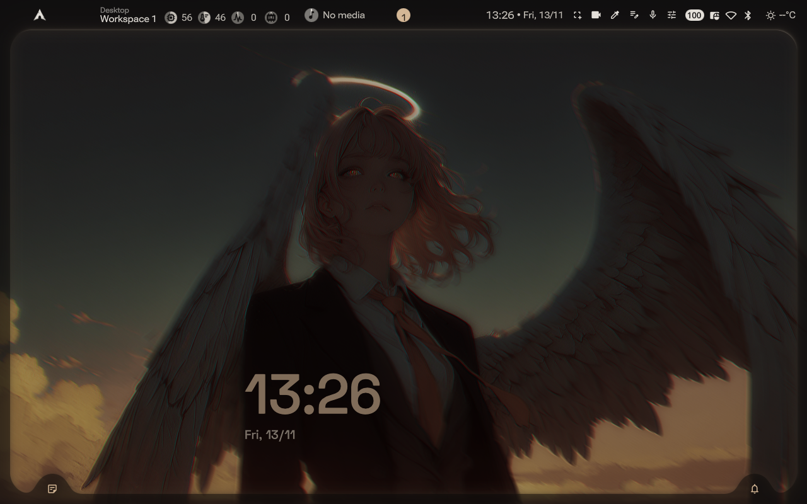
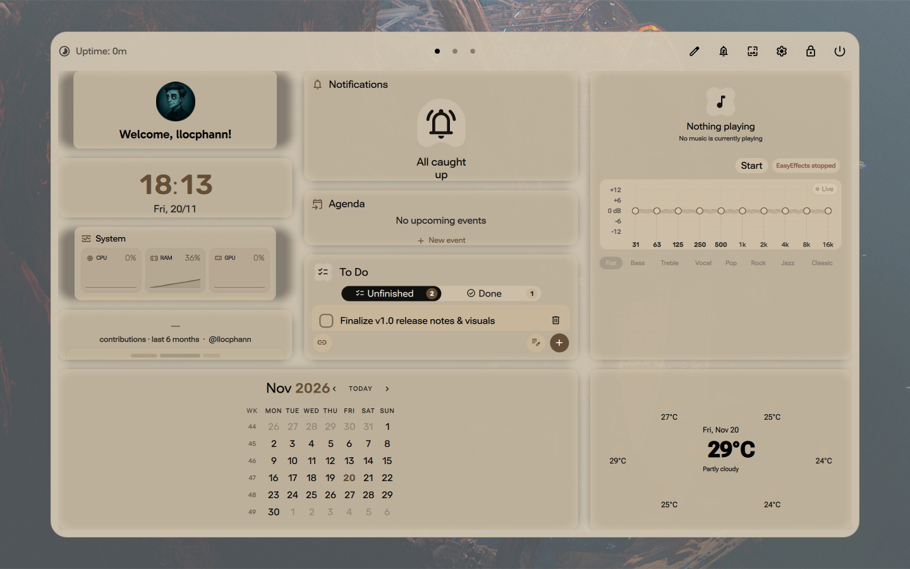
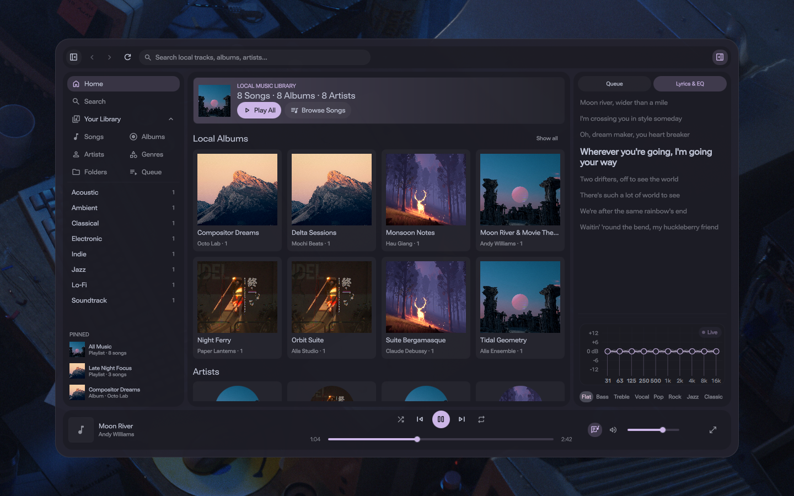
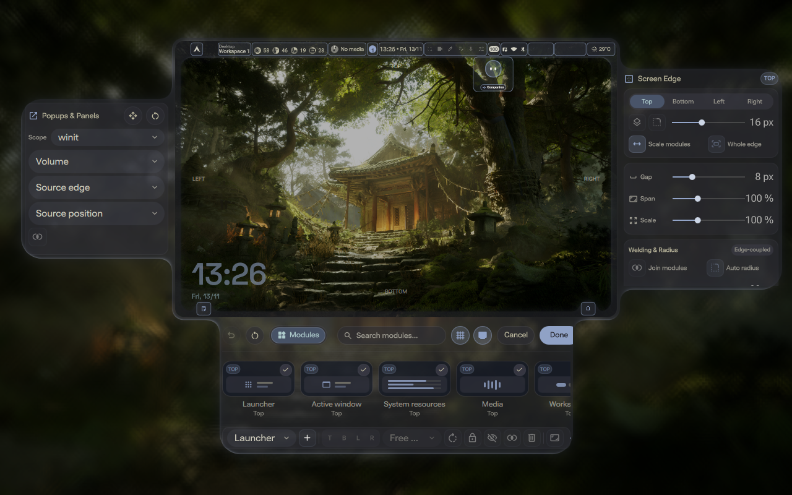
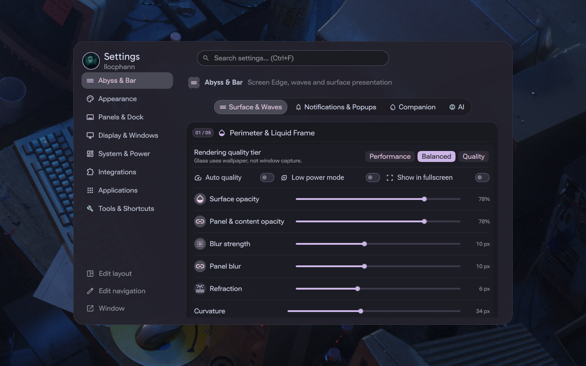
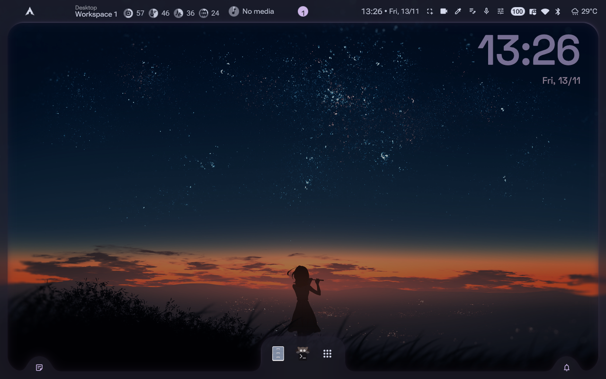
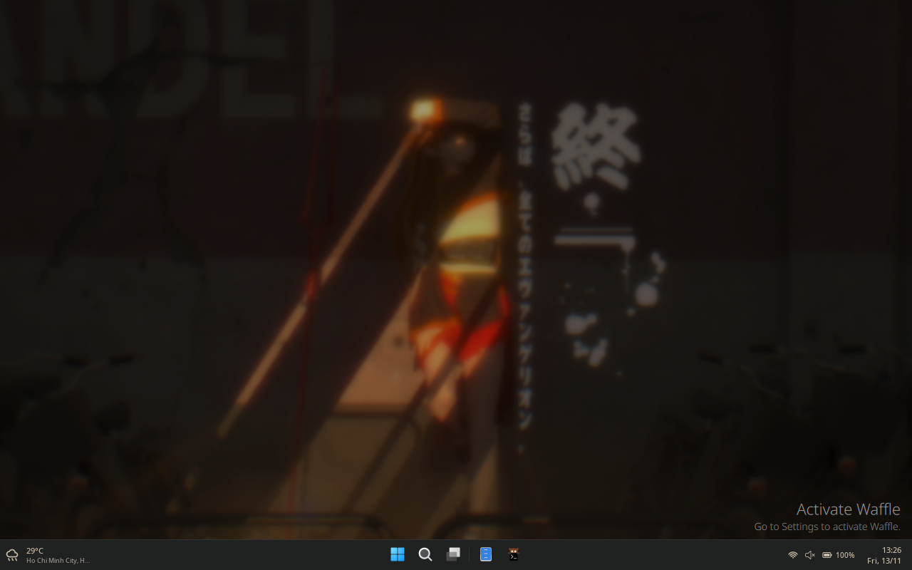

<div align="center">

# Alis `1.0.0`

**A responsive, Material You & Abyssal Wayland desktop shell built on Quickshell, Niri, and Rust.**

[](VERSION)
[](ARCHITECTURE.md)
[](#quick-start)
[](#ecosystem-repositories)

[Visual Showcase](#visual-showcase) · [Key Highlights](#key-highlights) · [Quick Start](#quick-start) · [Ecosystem](#ecosystem-repositories) · [Documentation](#documentation)

</div>

---

> **Transparency & Release Cadence**
> - **LLM-Assisted Engineering:** Alis, alongside its optional companion and integration packages, was **designed and built with the assistance of Large Language Models (LLMs)** for QML/Rust architecture iteration, shader prototyping, and automated testing under maintainer review.
> - **Release Schedule:** Alis `1.0.0` establishes the baseline release. Feature updates and maintenance releases are delivered on a **quarterly, semi-annual, or annual** cadence.

---

## Visual Showcase

Alis ships with adaptive Material You (`auto`) wallpaper extraction, curated light and dark palettes, and two distinct panel families: **Abyss** (continuous connected perimeter chrome) and **Waffle** (Windows 11-inspired taskbar and launcher).

| Abyss · Auto Wallpaper Palette | Angel · Twilight Warm Minimal |
| :---: | :---: |
|  |  |
| Adaptive wallpaper-derived palette, connected Abyss perimeter chrome, and live Quick Settings. | Warm amber twilight theme with low-glare desktop clock and minimalist framing. |

| Regalia Ivory · Unified Dashboard | Sonora-Inspired Local Music & Equalizer |
| :---: | :---: |
|  |  |
| Crisp card layout for Weather, Calendar, To Do, Notifications, Agenda, GitHub, System & Audio. | Collapsible library sidebar, artwork grid, search bar, and synced Lyrics stacked over the 10-band EQ. |

| Kanagawa · Live Desktop Edit Stage | Abyss Panel Style · Compact Settings |
| :---: | :---: |
|  |  |
| Synchronized Desktop Edit Stage with centered desktop preview and external edge docks. | Dashboard-sized Settings overlay with centered section tabs and clean single-column control plates. |

| Catppuccin Mocha · Night Skies | Gruvbox Material · Waffle Taskbar |
| :---: | :---: |
|  |  |
| Pastel lavender contrast over night photography with floating centered Abyss dock. | Switch anytime to the Waffle family with taskbar, Start Menu, and Start-Menu-sized Dashboard. |

---

## Key Highlights

- **Connected Abyssal Chrome & Flexible Customization:** Customize Screen Edges, Popups & Panels, Dashboard widget grids, and Desktop Widgets cleanly from a synchronized Desktop Edit Stage (`Super + G` / Edit buttons) with pure slide transitions.
- **Sonora-Inspired Local Music Player:** Browse local tracks, albums, artists, genres, folders, and playlists with hardware-friendly MPD playback, synced Lyrics stacked cleanly over a 10-band Equalizer, and shuffle/queue controls.
- **Responsive Dashboard & Compact Settings:** Clean responsive card projection adapts to any screen ratio, paired with compact Settings featuring single-column forms, lazy wallpaper baking for Favourites transitions, and fast indexed wallpaper search.
- **In-Desktop Capture & Inline Annotation:** Capture screenshots (`Super + Shift + S`), screen recordings, or OCR directly on the full-scale desktop with an auto-hiding compact toolbar and direct pen, highlight, arrow, shape, and text annotations.
- **Rust-Accelerated System Plumbing:** Native Rust daemons (`alis-theme`, `alis-inputd`, `alis-mpdd`, `alis-native`) keep Qt/QML rendering responsive while automatically syncing derived color themes to GTK, Qt, terminals, and editors.
- **Optional Modular Add-ons (Default-Off):** Keep the desktop clean out of the box or enable [Alis-Companion](https://github.com/llocphann/Alis-Companion) (3D liquid desktop pets, AI assistant & Nexus RAG) and [Alis-Intergration](https://github.com/llocphann/Alis-Intergration) (Nexus vault suite, Spaced Repetition, Exercises Tracker, TLP & Thinkfan).

---

## Quick Start

### Prerequisites

- **Compositor:** `niri` (Wayland session)
- **Runtime:** Quickshell (`v0.3.2` via `alis-deps`)
- **Toolchain:** `rust` / `cargo`, `python3`, `fish`, `git`

### Install on Arch Linux / CachyOS

```bash
git clone https://github.com/llocphann/Alis.git
cd Alis
./setup install
```

Check or restart the supervised user service:

```bash
systemctl --user status alis.service
alis restart
```

### Default Keybindings

| Shortcut | Action |
| :--- | :--- |
| `Super + Space` | App & command launcher |
| `Super + W` | Wallpaper & theme picker |
| `Super + G` | Overview / Workspace switcher |
| `Super + Shift + S` | Screenshot, Recording & OCR region tool |
| `Super + E` | File manager |
| `Super + ,` | Settings |
| `Super + /` | Keyboard & cheatsheet popup |

---

## Ecosystem Repositories

| Repository | Branch | Scope |
| :--- | :--- | :--- |
| **[Alis](https://github.com/llocphann/Alis)** | `stable` / `dev` | Core desktop shell, Abyss & Waffle panel families, Dashboard, Local Music, Capture, Settings & Rust daemons |
| **[Alis-Companion](https://github.com/llocphann/Alis-Companion)** | `main` | Optional Aqua & Octo 3D desktop companions, local-first AI agent, Voice, Nexus RAG & standalone `/swarm` |
| **[Alis-Intergration](https://github.com/llocphann/Alis-Intergration)** | `main` | Optional Nexus Vault workspace, Spaced Repetition flashcards, Exercises Tracker, TLP & Thinkfan plugins |

---

## Documentation

- [ARCHITECTURE.md](ARCHITECTURE.md) — Panel families, singletons, theming pipeline, IPC targets, and surface contracts
- [STRUCTURE.md](STRUCTURE.md) — Codebase directory guide and conventions
- [CONTRIBUTING.md](CONTRIBUTING.md) — Branch model (`dev` / `stable`), development workflow, and checks
- [CHANGELOG.md](CHANGELOG.md) — Version history and notable updates

Active issues and feature requests are tracked on [GitHub Issues](https://github.com/llocphann/Alis/issues).

---

## License

See [LICENSE](LICENSE).
